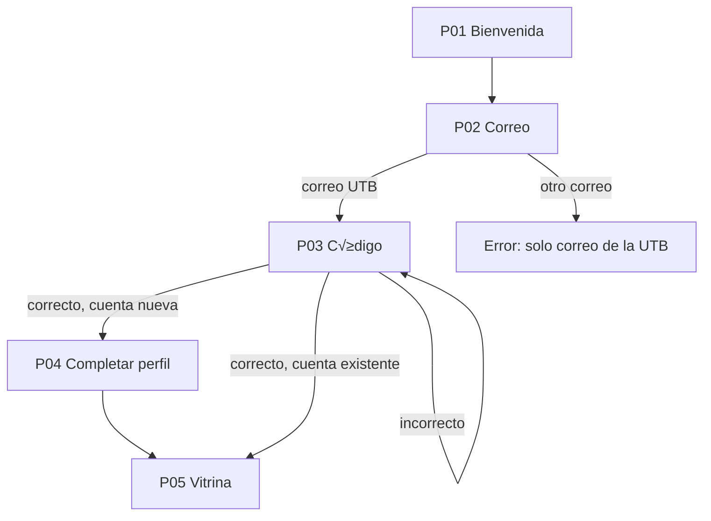
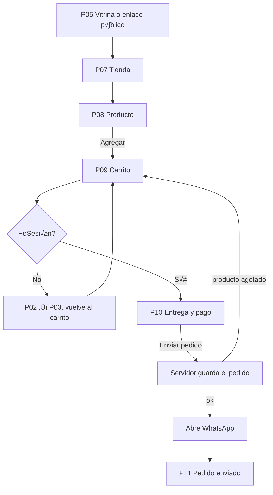

# PRD MAESTRO PROMPT: PuntoKampus (Tramo 1)

> **Cómo usar este archivo en Antigravity IDE**
> 1. Crea la carpeta del proyecto y √°brela como workspace en Antigravity.
> 2. Guarda este archivo como `docs/PRD-MAESTRO.md`.
> 3. Copia la sección **"REGLAS PERMANENTES"** (parte 2) en `AGENTS.md` en la raíz (o como regla de workspace en `.agent/rules/`), para que el agente la tenga siempre presente.
> 4. Elige el modelo **Claude Sonnet 4.6 (Thinking)** y el modo **Planning**.
> 5. Pega en el chat del Agent Manager el bloque **"PROMPT DE ARRANQUE"** (parte 1). Después avanza **fase por fase** (parte 12), aprobando cada plan.

---

# PARTE 1. PROMPT DE ARRANQUE (pegar en el chat)

```
Eres el ingeniero principal de PuntoKampus. Vas a construir el tramo 1 de la plataforma siguiendo
al pie de la letra el documento docs/PRD-MAESTRO.md. Léelo completo antes de hacer cualquier cosa.

Cómo trabajarás:
1. Trabaja en modo Planning. Para cada fase (F0 a F7 de la parte 12) primero genera un Implementation Plan
   como artefacto: archivos que crearás o cambiarás, paquetes nuevos (con justificación) y pruebas que escribirás.
   ESPERA mi aprobación antes de escribir código de esa fase.
2. Una fase a la vez. Nunca empieces la siguiente sin que yo diga "aprobada la fase X".
3. Al terminar cada fase entrega un Walkthrough como artefacto con: qué quedó funcionando, qué historias
   (H01…H27) y reglas (R1…R31) pasan, resultado de las pruebas automáticas (salida real de la terminal),
   y qué quedó pendiente o dudoso.
4. Si algo no est√° en el PRD o dos partes se contradicen, NO lo inventes: preg√∫ntame, ofreciendo 2 opciones
   y tu recomendación. Las ambigüedades ya detectadas están en la parte 13.
5. No agregues nada del tramo 2 (parte 11). Si se te ocurre una mejora, anótala en docs/ideas-tramo-2.md.
6. Nunca ejecutes comandos destructivos (borrar carpetas, resetear bases de datos que no sean de pruebas,
   git push --force) sin pedirme confirmación. Nunca subas .env, claves ni tokens.
7. Verifica con evidencia: ejecuta las pruebas y muestra el resultado; en la app web usa el navegador
   para recorrer los flujos principales y adjunta capturas.

Empieza ahora: lee docs/PRD-MAESTRO.md, resume en 10 líneas lo que entendiste, lista tus dudas
(si las hay) y entrega el Implementation Plan de la FASE 0.
```

---

# PARTE 2. REGLAS PERMANENTES (copiar a `AGENTS.md`)

```markdown
# PuntoKampus: reglas del agente

Vitrina digital para que los estudiantes de la Universidad Técnica de Babahoyo (UTB) vendan a la
comunidad universitaria. Requisitos completos en docs/PRD-MAESTRO.md. Léelo antes de programar algo nuevo.

## Estructura
- servidor/ : Laravel (PHP 8.3+) con API REST en /api/v1, PostgreSQL, Laravel Sanctum (tokens), Filament (panel en /admin).
- app/      : Flutter (Material 3). Un solo código para Android y web.
- docs/     : PRD-MAESTRO.md, registro-ia.md, ideas-tramo-2.md.

## Reglas que no se rompen
1. Fuente de verdad: las tablas, campos, rutas y reglas R1 a R31 de docs/PRD-MAESTRO.md. Nombres de tablas,
   campos y rutas en español y sin tildes, exactamente como están escritos. Si algo no está, pregunta.
2. No agregues funciones del tramo 2 ni nada que no esté en el alcance del tramo 1.
3. Todo texto visible al usuario va en español, de tú, con las palabras del catálogo de textos (parte 8.6).
   Código, variables y comentarios pueden ir en inglés, salvo nombres de tablas, campos y rutas.
   Vocabulario fijo: "tienda" (no negocio/local), "pedido" (no orden), "vitrina" (no cat√°logo).
4. Toda regla de negocio se valida en el servidor. La app valida solo para ayudar; el servidor decide
   (el total del pedido siempre lo calcula el servidor).
5. Cada ruta protegida comprueba que el usuario solo toca lo suyo. Cada ruta con candado lleva una prueba
   con un usuario ajeno que debe recibir 403 o 404.
6. Cada regla R1..R31 implementada lleva al menos una prueba autom√°tica (Pest en servidor; widget tests en Flutter
   para formularios de tienda, producto y pedido).
7. Nunca subir .env, contraseñas, claves ni tokens. Mantener .env.example actualizado.
8. No instales paquetes sin decir cuál, para qué y si está mantenido. Prefiere lo que ya trae Laravel/Flutter.
9. Fotos de comprobantes: almacenamiento privado (fuera de public/), servidas solo por el servidor a un
   admin o al dueño de la solicitud.
10. Toda pantalla con datos tiene estado de carga (esqueletos), vacío y error. Botones de al menos 48x48 dp,
    etiquetas visibles sobre los campos, contraste 4.5:1, texto normal 16, mínimo 12.
11. Antes de escribir código di qué archivos vas a crear/cambiar y por qué. Cambios pequeños, uno por historia.
    Al terminar, di qué prueba de las historias ya pasa.
12. Si una instrucción mía contradice el PRD, avísame antes de seguir.
13. Si dudas de una versión de Laravel, Filament o Flutter, consulta la documentación oficial en vez de suponer.
14. Commits pequeños en español con formato "H05: crear tienda" o "F2: tablas y migraciones".
```

---

# PARTE 3. CONTEXTO DEL PRODUCTO

**PuntoKampus** es una vitrina digital para los negocios de estudiantes de la UTB (Babahoyo, Ecuador). El estudiante que vende publica su tienda y productos; cualquier persona de la comunidad universitaria la encuentra, hace un pedido y lo recibe en un punto del campus. **El pago no pasa por la plataforma**: va directo del comprador al vendedor (efectivo, transferencia o Deuna).

**Problema:** hoy los vendedores se promocionan de boca en boca o en grupos de WhatsApp donde la publicación se pierde; los compradores no saben quién vende qué ni si el vendedor es un estudiante real. PuntoKampus junta todo en un lugar y solo deja entrar con correo institucional.

## 3.1 Usuarios

| Usuario | Quién es | Qué necesita |
|---|---|---|
| Comprador | Estudiante UTB con correo institucional | Encontrar rápido quién vende lo que busca, pedir sin escribir a mano, saber que el vendedor es real |
| Vendedor | Estudiante UTB con negocio propio | Mostrar productos a toda la universidad, recibir pedidos ordenados, dejar de recorrer aulas |
| Administrador | Equipo de PuntoKampus | Vigilar tiendas, atender reportes, activar planes pagados (usa el panel Filament, no la app) |
| Visitante | Cualquiera con el enlace de una tienda | Ver la tienda. No puede pedir |

Una cuenta puede comprar y, si crea una tienda, también vender. Máximo **una tienda por cuenta**.

## 3.2 Acceso

- Solo correos que terminan en `utb.edu.ec`, incluidos subdominios (`fafi.utb.edu.ec`).
- Registro y entrada: la persona escribe su correo y recibe un **código de 6 dígitos**. **No hay contraseñas.** La sesión queda abierta en el dispositivo hasta que salga (o hasta el fin del periodo académico).
- Perfil del vendedor: nombres, código de estudiante, facultad, carrera, semestre y WhatsApp. **No se pide cédula.**
- El WhatsApp del vendedor solo se muestra al público si él lo decide.

## 3.3 Alcance del tramo 1 (lo √∫nico que se construye)

1. Registro y entrada con correo institucional y código de 6 dígitos.
2. Tienda del vendedor: crear y editar (nombre, logo, descripción, hasta 2 categorías, horario, punto de entrega).
3. Productos con hasta 3 fotos, precio y "disponible"/"agotado".
4. Vitrina por categorías, con búsqueda.
5. Enlace p√∫blico de cada tienda (`/t/{slug}`).
6. Pedido de una sola tienda: se guarda en BD como `pendiente` y luego se abre WhatsApp con el mensaje armado.
7. Pedidos del vendedor (marcar entregado/cancelado) y del comprador (ver estado, cancelar). Paso automático a `vencido` 24 h después de la hora de entrega.
8. Botón "Reportar tienda".
9. Solicitud de Premium con foto y número del comprobante. Beneficios: insignia "Sacó 10", portada propia, pedidos sin límite.
10. Panel del administrador (Filament): tiendas, bajas con motivo, reportes, solicitudes Premium, usuarios, pedidos (solo lectura), categorías, puntos de entrega, configuración y resumen del piloto.
11. Política de privacidad aceptada al registrarse, visible en la app, y opción de borrar la cuenta.

**Insignias:** tienda plan gratis = "Matriculado"; Premium = "Sacó 10".

## 3.4 "Terminado" significa

- Cada función pasa sus pruebas de aceptación (parte 9) en un celular Android y en el navegador de un celular.
- Est√° en un servidor en internet con HTTPS, no solo en la m√°quina local.
- El APK de Android se instala directo (sin Google Play).
- El correo con el código llega a correos institucionales reales.
- Alguien ajeno al equipo crea una tienda y hace un pedido sin ayuda.

---

# PARTE 4. ARQUITECTURA Y STACK

```
 App Android (Flutter) ─┐
 Versión web (Flutter) ─┼──► Servidor Laravel (API) ──► PostgreSQL
 Panel admin (Filament) ┘          │
                                   ├──► Correo (envía el código de 6 dígitos)
                                   └──► Archivos (fotos y comprobantes)
 Pedido ──► se guarda primero ──► se abre WhatsApp con el mensaje armado
```

| Pieza | Decisión |
|---|---|
| App y web | Flutter, un solo código (Material 3). Android + web |
| Servidor | Laravel (PHP) con API REST JSON |
| Auth API | Laravel Sanctum (tokens Bearer) |
| BD | PostgreSQL |
| Panel admin | Filament dentro del mismo Laravel, en `/admin` |
| WhatsApp | `https://wa.me/<n√∫mero>?text=<mensaje codificado>` (sin permisos de WhatsApp) |
| Fotos | La app las reduce antes de subir; el servidor las guarda con m√°ximo 1080 px por lado |
| Hosting | Servidor pequeño con PHP + PostgreSQL, presupuesto máximo $15/mes |
| Respaldos | Copia diaria de la BD, guardada fuera del servidor |

**Requisitos generales:** funciona en Android de gama baja; la web funciona en Chrome Android y Safari iPhone; todo en español (textos, errores y correos); HTTPS en todo; cumplir la Ley Orgánica de Protección de Datos Personales de Ecuador y la política de Datos del Usuario de Google Play.

**Riesgo a medir:** la versión web de Flutter tarda en abrir la primera vez. Medir el tiempo con datos móviles en la Fase 3 y anotarlo.

**Estructura de repositorio sugerida**

```
puntokampus/
├── AGENTS.md
├── docs/ (PRD-MAESTRO.md, registro-ia.md, ideas-tramo-2.md)
├── servidor/   (Laravel + Filament)
└── app/        (Flutter)
```

---

# PARTE 5. MODELO DE DATOS (PostgreSQL)

Nombres en español sin tildes, exactamente así. Todas las tablas con `creado_en`/`actualizado_en` salvo indicación.

### usuarios
| Campo | Tipo | Regla |
|---|---|---|
| id | bigint | PK |
| correo | texto √∫nico | Termina en `utb.edu.ec` o subdominio. Se guarda en min√∫sculas |
| nombres | texto | Obligatorio |
| codigo_estudiante | texto | Solo vendedores |
| facultad, carrera | texto | Solo vendedores |
| semestre | entero 1..10 | Solo vendedores |
| whatsapp | texto | Solo vendedores. Formato internacional: `09XXXXXXXX` ‚Üí `5939XXXXXXXX` |
| mostrar_whatsapp | booleano | `false` por defecto |
| es_admin | booleano | `false` por defecto. Solo se cambia desde BD o panel |
| acepto_privacidad_en | timestamp | Obligatorio para usar la plataforma |
| estado | `activa` \| `desactivada` | |

El comprador solo necesita correo y nombres. Los demás datos se piden al crear tienda (mínimo necesario, ley de datos).

### codigos_acceso
`id`, `correo`, `codigo_hash` (nunca en claro), `expira_en` (10 min), `intentos` (máx. 5; al quinto fallo el código deja de servir), `usado_en` (uso único).

### tiendas
| Campo | Tipo | Regla |
|---|---|---|
| id | bigint | |
| usuario_id | bigint √∫nico | Una tienda por cuenta |
| nombre | texto 3..40 | |
| slug | texto √∫nico | Sale del nombre (`dulces-de-ana`) |
| descripcion | texto ≤300 | |
| logo_url | texto | Opcional |
| portada_url | texto | Solo Premium |
| categoria_1_id | bigint | Obligatoria |
| categoria_2_id | bigint | Opcional, distinta de la primera |
| horario | texto ≤100 | Libre. Ej. "Lunes a viernes, 8:00 a 14:00" |
| punto_entrega_id | bigint | Punto habitual |
| plan | `gratis` \| `premium` | `gratis` por defecto |
| premium_hasta | fecha | Fin del periodo académico pagado |
| estado | `activa` \| `dada_de_baja` | `activa` al crearse |
| motivo_baja | texto | Obligatorio si est√° dada de baja |
| dada_de_baja_en | timestamp | |

### categorias y puntos_entrega
Ambas: `id`, `nombre`, `activa`, `orden`. `puntos_entrega` añade `descripcion`.
- Categorías iniciales (seeder): Comida, Postres y dulces, Bebidas, Ropa y accesorios, Tecnología, Útiles y papelería, Servicios, Otros.
- Puntos iniciales (seeder): la biblioteca y la entrada de cada facultad (lista definitiva sale de una encuesta; se maneja desde el panel).

### productos y producto_fotos
`productos`: `id`, `tienda_id`, `nombre` (3..60), `descripcion` (≤300, opcional), `precio` numeric(8,2) (>0 y ≤500), `disponible` (default true), `eliminado_en` (borrado suave).
`producto_fotos`: `id`, `producto_id`, `url`, `orden`. M√°ximo 3 por producto.

### pedidos y pedido_items
`pedidos`: `id`, `codigo` único (`PK-000123`), `comprador_id`, `tienda_id`, `punto_entrega_id`, `hora_entrega` (desde +30 min hasta +7 días), `forma_pago` (`efectivo`|`transferencia`|`deuna`), `nota` (≤200, opcional), `total` numeric(8,2) (**lo calcula el servidor**), `estado` (`pendiente`|`entregado`|`cancelado`|`vencido`), `cancelado_por` (`comprador`|`vendedor`|`sistema`), `estado_cambiado_en`.
`pedido_items`: `id`, `pedido_id`, `producto_id`, `nombre_producto`, `precio_unitario`, `cantidad` (1..20), `subtotal`. **Nombre y precio se copian al momento del pedido.**

### reportes
`id`, `tienda_id`, `reportado_por`, `motivo` (`prohibido`|`no_entrego`|`informacion_falsa`|`trato_inadecuado`|`otro`), `detalle` (≤300, obligatorio si motivo=`otro`), `estado` (`nuevo`|`sin_accion`|`tienda_dada_de_baja`), `revisado_por`, `revisado_en`, `nota_admin`.

### solicitudes_premium
`id`, `tienda_id`, `numero_comprobante` (obligatorio), `monto` numeric(8,2), `foto_comprobante` (ruta **privada**), `estado` (`pendiente`|`aprobada`|`rechazada`), `motivo_rechazo` (obligatorio si se rechaza), `revisado_por`, `revisado_en`, `foto_borrada_en`.

### configuracion (una sola fila, editable en el panel)
Precio del Premium, datos de la cuenta de pago (banco, tipo de cuenta, número, titular, usuario de Deuna), fecha de fin del periodo académico, días que se guarda la foto del comprobante (propuesta 30), y `limite_pedidos_gratis` (**vacío = sin límite; vacío en el tramo 1**; el límite debe quedar programado como valor configurable pero desactivado).

---

# PARTE 6. REGLAS DE NEGOCIO (R1 a R31)

### Acceso
1. Solo correos de `utb.edu.ec` y subdominios. Otro correo → error y no se envía nada.
2. Para pedir código nuevo hay que esperar 60 s. Máximo 5 códigos por correo cada hora.
3. Si el correo no tiene cuenta, al verificar el código se crea. La persona completa nombres y acepta la política de privacidad antes de seguir.
4. La sesión dura hasta que la persona sale o hasta el fin del periodo académico (entonces vuelve a entrar con código).
5. Una cuenta `desactivada` no puede entrar.

### Tiendas
6. Al crear tienda se piden datos de vendedor (código de estudiante, facultad, carrera, semestre, WhatsApp) si la cuenta no los tiene.
7. La tienda se publica al crearse. No hay aprobación previa.
8. Una tienda `dada_de_baja` no aparece en vitrina ni b√∫squeda; su enlace muestra "Esta tienda no est√° disponible"; sus pedidos `pendiente` pasan a `cancelado` con `cancelado_por = sistema`; el vendedor ve el motivo al entrar.
9. Solo el administrador da de baja y reactiva.
10. La portada solo se sube si la tienda es Premium. Si el Premium vence, la portada deja de mostrarse pero no se borra.

### Pedidos
11. Un pedido es de una sola tienda; todos sus productos son de esa tienda y est√°n disponibles.
12. Nadie puede pedirle a su propia tienda.
13. No se puede pedir a una tienda dada de baja.
14. El servidor calcula el total con precios del momento. Si un producto ya no est√° disponible, rechaza el pedido (422) y dice cu√°l.
15. El pedido se guarda `pendiente` **antes** de abrir WhatsApp. El servidor devuelve `whatsapp_url` ya armado.
16. El comprador cancela solo si el pedido sigue `pendiente`.
17. El vendedor marca `entregado` o `cancelado` solo si sigue `pendiente`.
18. A las 24 h de la `hora_entrega`, si sigue `pendiente`, pasa a `vencido` (tarea programada cada hora).
19. `limite_pedidos_gratis` está vacío en el tramo 1 (no aplicar límite).

### Mensaje de WhatsApp (lo arma el servidor)
```
Hola, soy Ana Pérez. Te hice un pedido por PuntoKampus (PK-000123):
- 2 x Empanada de queso: $3.00
- 1 x Jugo de naranja: $1.00
Total: $4.00
Entrega: Biblioteca, jueves 19/11 a las 10:30
Pago: Transferencia
Nota: sin cebolla, por favor
```
Enlace: `https://wa.me/5939XXXXXXXX?text=<mensaje codificado para URL>` (la línea "Nota" solo si hay nota).

### Reportes
20. Una persona puede reportar la misma tienda una vez cada 24 h (si no, 429/422 con el texto de "Ya reportó hoy").
21. No se puede reportar la tienda propia.
22. El dueño del producto revisa cada reporte en 24 h. Si da de baja la tienda → `tienda_dada_de_baja`; si no → `sin_accion` con nota.

### Premium
23. M√°ximo una solicitud `pendiente` por tienda.
24. El `numero_comprobante` no puede repetirse en otra solicitud **aprobada**.
25. Al aprobar: tienda `premium` y `premium_hasta` = fecha de fin del periodo (configuración).
26. Al rechazar, el motivo es obligatorio y el vendedor lo ve.
27. Cuando `premium_hasta` pasa, la tienda vuelve a `gratis` (tarea diaria).
28. La foto del comprobante solo la ven administradores (y el dueño antes de que se borre); se borra según el plazo de configuración (tarea diaria). Se conservan número y monto.

### Borrar la cuenta
29. Desde la app (Cuenta → Borrar mi cuenta, con código de confirmación) y desde la web `/borrar-cuenta`.
30. Al borrar: se eliminan datos personales, tienda, productos, fotos y comprobantes. En pedidos con otros, el nombre pasa a "Usuario eliminado".
31. Se hace al momento.

---

# PARTE 7. PERMISOS Y API

## 7.1 Permisos

| Acción | Visitante | Comprador | Vendedor | Admin |
|---|---|---|---|---|
| Ver vitrina, tiendas, productos | Sí | Sí | Sí | Sí |
| Hacer pedido | No | Sí | Sí (a otras tiendas) | Sí |
| Reportar tienda | No | Sí | Sí (a otras) | No aplica |
| Crear/editar su tienda y productos | No | Puede crear una | Sí | No |
| Ver y cambiar pedidos de su tienda | No | No | Sí | Solo ver |
| Pedir Premium | No | No | Sí | No |
| Dar de baja / reactivar | No | No | No | Sí |
| Revisar reportes y solicitudes Premium | No | No | No | Sí |
| Ver comprobantes | No | No | Solo los suyos (antes de borrarse) | Sí |

"Comprador" = cualquier persona con sesión. "Vendedor" = quien además tiene tienda.

## 7.2 API (`/api/v1`, JSON; üîí = `Authorization: Bearer <token>`)

Errores formato Laravel con textos en español:
```json
{ "message": "Revisa los datos del pedido.", "errors": { "items.0.producto_id": ["Este producto ya no est√° disponible."] } }
```
Códigos: 401 sin token/vencido · 403 sin permiso (ej. portada sin Premium) · 404 no existe o tienda dada de baja · 422 datos inválidos · 429 demasiados intentos.

**Acceso y cuenta**

| Ruta | Envía | Responde |
|---|---|---|
| `POST /auth/codigo` | `correo` | 204 (envía el código por correo) |
| `POST /auth/verificar` | `correo`, `codigo`, `dispositivo` | `token`, `usuario`, `es_nuevo` |
| `POST /auth/salir` üîí | | 204 (revoca el token) |
| `GET /yo` üîí | | Cuenta + resumen de su tienda si tiene |
| `PUT /yo` 🔒 | `nombres`, `acepto_privacidad` (obligatorio la 1.ª vez), datos de vendedor, `mostrar_whatsapp` | Cuenta actualizada |
| `POST /yo/codigo-borrado` 🔒 | | 204 (envía código de confirmación) |
| `DELETE /yo` 🔒 | `codigo` | 204 (reglas 29–31) |

**Vitrina (sin sesión)**

| Ruta | Envía | Responde |
|---|---|---|
| `GET /categorias` | | Categorías activas |
| `GET /puntos-entrega` | | Puntos activos |
| `GET /tiendas` | `categoria`, `buscar`, `pagina` | Tiendas activas, 20 por p√°gina |
| `GET /tiendas/{slug}` | | Tienda con productos no eliminados |
| `GET /productos` | `categoria`, `buscar`, `pagina` | Productos de tiendas activas, 20 por p√°gina |

Búsqueda: nombre de tienda, nombre de producto y descripción, **sin distinguir mayúsculas ni tildes** (en PostgreSQL usar `unaccent` + `ILIKE`). La categoría filtra por categoría 1 **o** 2.

**Mi tienda üîí**

| Ruta | Envía | Responde |
|---|---|---|
| `POST /mi-tienda` | Datos de tienda (+ vendedor si faltan) | Tienda creada |
| `GET /mi-tienda` | | Tienda, plan, estado, motivo de baja |
| `PUT /mi-tienda` | Campos editables | Tienda actualizada |
| `POST /mi-tienda/logo` | Imagen | `logo_url` |
| `POST /mi-tienda/portada` | Imagen | `portada_url` (403 si no es Premium) |
| `GET /mi-tienda/productos` | | Productos de la tienda |
| `POST /mi-tienda/productos` | `nombre`, `descripcion`, `precio`, `disponible` | Producto creado |
| `PUT /mi-tienda/productos/{id}` | Campos | Producto actualizado |
| `DELETE /mi-tienda/productos/{id}` | | 204 (borrado suave) |
| `POST /mi-tienda/productos/{id}/fotos` | Imagen | Foto agregada (422 si ya tiene 3) |
| `DELETE /mi-tienda/productos/{id}/fotos/{foto}` | | 204 |
| `GET /mi-tienda/pedidos` | `estado` | Pedidos recibidos, m√°s nuevos primero |
| `POST /mi-tienda/pedidos/{id}/entregado` | | Pedido actualizado |
| `POST /mi-tienda/pedidos/{id}/cancelar` | | Pedido actualizado |

**Pedidos del comprador üîí**

| Ruta | Envía | Responde |
|---|---|---|
| `POST /pedidos` | `tienda_id`, `items[{producto_id,cantidad}]`, `punto_entrega_id`, `hora_entrega`, `forma_pago`, `nota` | `pedido` y `whatsapp_url` |
| `GET /pedidos` | `estado` | Mis pedidos, m√°s nuevos primero |
| `POST /pedidos/{id}/cancelar` | | Pedido actualizado |

**Reportes y Premium üîí**

| Ruta | Envía | Responde |
|---|---|---|
| `POST /tiendas/{id}/reportes` | `motivo`, `detalle` | 201 |
| `GET /premium` | | Precio, datos de la cuenta, estado del plan y de la √∫ltima solicitud |
| `POST /premium/solicitudes` | `numero_comprobante`, `monto`, foto | Solicitud `pendiente` |

**P√°ginas web del servidor (fuera de la API)**

| Ruta | Para qué |
|---|---|
| `/privacidad` | Política de privacidad (pública; su enlace va en Google Play) |
| `/borrar-cuenta` | Borrado desde la web con correo + código (lo exige Google Play) |
| `/admin` | Panel Filament, solo `es_admin` |

El enlace público `/t/{slug}` lo maneja la versión web de Flutter.

## 7.3 Panel Filament (`/admin`)

| Sección | Qué permite |
|---|---|
| Tiendas | Lista con filtros (estado, plan, categoría). "Dar de baja" (pide motivo) y "Reactivar" |
| Reportes | `nuevo` primero, con tienda y motivo. "Dar de baja la tienda" y "Cerrar sin acción" (pide nota) |
| Solicitudes Premium | `pendiente` primero, con foto del comprobante, n√∫mero y monto. "Aprobar" (bloquea si el n√∫mero ya fue usado en una aprobada) y "Rechazar" (pide motivo) |
| Usuarios | Lista, b√∫squeda por correo, "Desactivar" |
| Pedidos | Solo lectura; filtros por estado, tienda y fecha |
| Categorías y puntos de entrega | Crear, editar, ordenar, activar/desactivar |
| Configuración | La fila de `configuracion` |
| Resumen del piloto | Por semana: tiendas creadas, productos publicados, pedidos (registrados/entregados/cancelados/vencidos), compradores distintos con ‚â•1 pedido, solicitudes Premium enviadas y aprobadas, reportes recibidos |

El panel debe estar protegido: solo usuarios con `es_admin = true` (el admin entra con el mismo código por correo o con un acceso propio de Filament; decidir y preguntar, ver parte 13).

---

# PARTE 8. APP FLUTTER: PANTALLAS, FLUJOS Y TEXTOS

## 8.1 Navegación
Barra inferior de 4 secciones (visible con sesión): **Vitrina** (P05) · **Mis pedidos** (P12) · **Mi tienda** (P15 si tiene; si no, invitación a crear → P14) · **Cuenta** (P13). Sin sesión solo se ven vitrina, tiendas y botón "Entrar". Deep link `/t/{slug}` abre la tienda con o sin sesión (rutas con `go_router` o equivalente, URLs limpias en web).

## 8.2 Pantallas

| Código | Pantalla | Contenido |
|---|---|---|
| P01 | Bienvenida | Frase de qué es PuntoKampus; "Entrar con mi correo UTB" y "Ver la vitrina" |
| P02 | Correo | Campo correo (teclado de correo), "Enviarme el código" |
| P03 | Código | 6 casillas (teclado numérico), "Reenviar código" con cuenta regresiva de 60 s, "Cambiar correo" |
| P04 | Completar perfil | Nombres, casilla "Acepto la política de privacidad" (enlace a P21), "Continuar" |
| P05 | Vitrina | Buscador, categorías en fila deslizable, lista de tiendas (logo, nombre, insignia, categoría, punto de entrega), paginación 20 en 20 |
| P06 | Resultados de búsqueda | Pestañas "Productos" y "Tiendas" |
| P07 | Tienda | Portada (si Premium), logo, nombre, insignia, descripción, horario, punto de entrega, WhatsApp (si lo muestra), productos, botón "Reportar" (no en tienda propia) |
| P08 | Producto | Fotos, nombre, precio, descripción, "Agotado" si aplica, selector de cantidad (1..20), "Agregar al carrito" (oculto en tienda propia) |
| P09 | Carrito | Productos, cantidades, total, "Continuar" |
| P10 | Entrega y pago | Punto de entrega, día y hora, forma de pago, nota, total, "Enviar pedido" (se desactiva mientras espera) |
| P11 | Pedido enviado | Código del pedido, "Tu pedido quedó registrado", "Abrir WhatsApp" (por si no se abrió solo), "Ver mis pedidos" |
| P12 | Mis pedidos | Lista (código, tienda, fecha, total, estado). Detalle y "Cancelar pedido" si pendiente |
| P13 | Cuenta | Mis datos, "Mostrar mi WhatsApp en mi tienda", "Política de privacidad", "Salir", "Borrar mi cuenta" |
| P14 | Crear o editar tienda | Datos de vendedor (si faltan) y de tienda, logo, portada (con candado si no es Premium) |
| P15 | Mi tienda | Vista previa, "Compartir enlace", accesos a productos, pedidos y Premium. Si está dada de baja: motivo y cómo escribir al equipo |
| P16 | Producto nuevo/editar | Nombre, precio, descripción, hasta 3 fotos, interruptor "Disponible" |
| P17 | Pedidos de mi tienda | Filtro por estado; cada pedido con comprador, productos, punto, hora, pago, botones "Entregado" y "Cancelar" |
| P18 | Premium | Plan actual, precio, beneficios, datos de la cuenta para pagar, formulario del comprobante, estado de la √∫ltima solicitud |
| P19 | Reportar tienda | Hoja desde abajo: motivos, detalle, "Enviar reporte" |
| P20 | Tienda no disponible | "Esta tienda no est√° disponible" + "Ir a la vitrina" |
| P21 | Política de privacidad | Texto de la política |
| P22 | Borrar cuenta | Qué se borra, código de confirmación, "Borrar mi cuenta para siempre" |

## 8.3 Flujos clave





Premium: P15 → P18 → el vendedor paga fuera de la app → sube foto, número y monto → "En revisión" → aprobada (insignia "Sacó 10" + portada) o rechazada (ve el motivo y puede reenviar).
Baja: el admin da de baja con motivo ‚Üí tienda fuera de vitrina, pedidos pendientes cancelados, el vendedor ve el motivo en P15, escribe al equipo, el admin puede reactivar.

## 8.4 Estados obligatorios en toda pantalla con datos

| Estado | Qué se ve |
|---|---|
| Cargando | Esqueletos grises con la forma del contenido (no pantalla en blanco) |
| Vacío | Qué es la sección, por qué está vacía y qué hacer |
| Error de conexión | "No pudimos conectarnos. Revisa tu internet e inténtalo de nuevo" + botón "Reintentar" |
| Error del servidor | "Algo falló de nuestro lado. Inténtalo en unos minutos" |

## 8.5 Reglas de diseño (desde el día 1)

Botones ≥ 48×48 dp con 8 dp de separación · texto normal 16, nunca < 12 · contraste ≥ 4.5:1 · etiqueta visible sobre cada campo (el hint gris no la reemplaza) · error debajo del campo que falló · ningún botón solo con ícono sin texto/semántica · todo botón responde al toque; "Enviar pedido" se desactiva mientras espera (evita doble envío) · listas con `ListView.builder` y paginación de 20 · fotos reducidas antes de subir y cacheadas al mostrar · el botón atrás (celular y navegador) siempre vuelve a la pantalla anterior · teclado correcto por campo (correo, precio y código numéricos). Diseño visual provisional con Material 3 (logo y colores se definen en semanas 3–4; dejar el tema centralizado en un solo archivo para cambiarlo fácil).

## 8.6 Cat√°logo de textos (usar literalmente)

**Botones:** P01 "Entrar con mi correo UTB" · P02 "Enviarme el código" · P03 "Entrar" · P04 "Continuar" · P08 "Agregar al carrito" · P10 "Enviar pedido" · P11 "Abrir WhatsApp" · P14 "Crear mi tienda" / "Guardar cambios" · P15 "Compartir enlace" · P17 "Entregado" / "Cancelar" · P18 "Enviar comprobante" · P19 "Enviar reporte" · P22 "Borrar mi cuenta para siempre".

**Errores**
- Correo no UTB: "Solo se puede entrar con un correo de la UTB (termina en utb.edu.ec)."
- Código incorrecto: "Ese código no es correcto. Te quedan {n} intentos."
- Código vencido: "Este código ya venció. Pide uno nuevo."
- Demasiados intentos: "Hiciste muchos intentos. Espera unos minutos y pide un código nuevo."
- Producto agotado al enviar: "{producto} se agotó mientras armabas tu pedido. Quítalo del carrito para continuar."
- Hora de entrega muy pronto: "Elige una hora desde las {hora mínima}. El vendedor necesita al menos 30 minutos."
- M√°s de 3 fotos: "Cada producto puede tener hasta 3 fotos."
- Ya reportó hoy: "Ya reportaste esta tienda hoy. Si pasa algo nuevo, puedes volver a hacerlo mañana."

**Pantallas vacías**
- Mis pedidos: "Todavía no has hecho pedidos. Busca en la vitrina lo que necesitas."
- Pedidos de mi tienda: "A√∫n no te llegan pedidos. Comparte el enlace de tu tienda en tus grupos para que te encuentren."
- Mis productos: "Tu tienda no tiene productos. Agrega el primero para aparecer en la vitrina."
- Búsqueda sin resultados: "No encontramos nada con «{texto}». Prueba con otra palabra o revisa las categorías."
- Categoría sin tiendas: "Todavía no hay tiendas en {categoría}. ¿Vendes algo así? Crea tu tienda."

**Confirmaciones**
- Cancelar pedido: "¿Cancelar el pedido {código}? El vendedor verá que lo cancelaste." [Cancelar pedido / Volver]
- Cambiar de tienda con carrito: "Tu carrito tiene productos de {tienda}. ¬øQuieres vaciarlo y empezar uno nuevo?" [Vaciar y continuar / Mantener carrito]
- Borrar producto: "¬øBorrar {producto}? Ya no aparecer√° en tu tienda." [Borrar producto / Volver]
- Borrar cuenta: "Se borrar√°n tu cuenta, tu tienda, tus productos y tus fotos. No se puede deshacer." [Borrar mi cuenta para siempre / Volver]

**Éxito**
- Pedido guardado: "Tu pedido {código} quedó registrado. Termina de enviarlo por WhatsApp."
- Tienda creada: "¬°Tu tienda ya est√° en la vitrina!"
- Comprobante enviado: "Recibimos tu comprobante. Ver√°s el resultado en esta misma pantalla cuando lo revisemos."
- Reporte enviado: "Gracias. El equipo lo revisar√° en 24 horas."

Textos de error que cubren otras reglas (ej. "No puedes pedirle a tu propia tienda", mensajes de validación de Laravel, correos del código) deben redactarse en español, tono cercano, de tú; propónlos en el plan y yo los apruebo.

**Correo del código:** asunto "Tu código de PuntoKampus: {codigo}"; cuerpo corto en español con el código, aviso de que vence en 10 minutos y de ignorarlo si no lo pidió.

---

# PARTE 9. HISTORIAS Y PRUEBAS DE ACEPTACIÓN

Formato: Dado / cuando / entonces. Una historia está terminada cuando **todas** sus pruebas pasan (Android + navegador móvil, servidor en internet).

**Acceso**
- **H01 Registro:** correo `@utb.edu.ec` sin cuenta → llega código de 6 dígitos en < 2 min. `@gmail.com` → error y no se envía nada. Subdominio `@fafi.utb.edu.ec` → llega igual. Código correcto → pide nombres y aceptar política, luego entra a vitrina. Sin aceptar la política no avanza.
- **H02 Entrar otra vez:** 5 códigos equivocados → el código deja de servir. Código > 10 min → "Este código ya venció. Pide uno nuevo". Pedir otro antes de 60 s → el botón muestra los segundos que faltan. Cerrar y abrir la app al día siguiente → sigue dentro.
- **H03 Salir:** "Salir" ‚Üí vuelve a bienvenida y el token deja de servir en el servidor.
- **H04 Borrar cuenta:** muestra qué se borra y envía código; con código correcto desaparecen cuenta, tienda, productos y fotos y se sale de la app; el vendedor ve "Usuario eliminado" en pedidos viejos; `/borrar-cuenta` funciona sin la app.

**Tienda y productos**
- **H05 Crear tienda:** pide datos de vendedor si faltan; WhatsApp `0991234567` → se guarda `593991234567`; aparece de inmediato en vitrina con "Matriculado"; misma categoría dos veces → error; si ya tiene tienda no se ofrece crear otra.
- **H06 Editar tienda:** cambios de nombre/horario/logo se ven en vitrina; plan gratis: portada muestra que es beneficio Premium y cómo obtenerlo; `mostrar_whatsapp` activo → el número aparece en la tienda pública, inactivo → no aparece en ningún lado.
- **H07 Productos:** agregar con nombre, precio y foto → aparece en tienda y vitrina; 4.ª foto → "Cada producto puede tener hasta 3 fotos"; precio 0 o > 500 → error; foto del celular de varios MB se sube (se reduce antes); borrar producto → desaparece de la tienda pero sigue en pedidos viejos.
- **H08 Agotado:** sigue visible con etiqueta "Agotado" y nadie lo puede agregar al carrito.

**Vitrina**
- **H09 Categorías:** se ven categorías y tiendas activas; "Postres y dulces" muestra tiendas con esa categoría como 1.ª o 2.ª; dada de baja no aparece; > 20 tiendas → carga más al llegar al final.
- **H10 Buscar:** "empanada" encuentra productos y tiendas por nombre o descripción; "EMPANADA" y "empanadá" dan lo mismo; sin resultados → texto de búsqueda vacía.
- **H11 Ver tienda:** nombre, logo, insignia, descripción, horario, punto, productos y portada si es Premium.
- **H12 Enlace público:** `/t/dulces-de-ana` sin sesión → tienda completa; "Pedir" pide entrar con correo UTB y vuelve a la misma tienda; tienda dada de baja → "Esta tienda no está disponible".

**Pedidos**
- **H13 Carrito:** producto de otra tienda → confirmación de vaciar; cantidad máxima 20; en la tienda propia no hay botón de agregar.
- **H14 Enviar pedido:** se guarda `pendiente` y se abre WhatsApp con el mensaje; producto agotado mientras elegía → dice cuál y no se crea el pedido; hora dentro de los próximos 30 min → no la deja elegir; total distinto al del servidor → manda el del servidor; sin WhatsApp instalado → igual queda guardado y abre WhatsApp Web.
- **H15 Mis pedidos:** lista con código, tienda, total y estado; cancelar pendiente → `cancelado`; entregado → sin opción de cancelar.
- **H16 Pedidos de mi tienda:** muestra comprador, productos, punto, hora y pago; filtro "Pendientes" funciona.
- **H17 Entregado/cancelado:** vendedor marca `entregado` y cambia para ambos; un `cancelado` no se puede marcar entregado.
- **H18 Vencidos:** pedido `pendiente` con hora de entrega pasada hace > 24 h ‚Üí `vencido` al correr la tarea.

**Reportes**
- **H19 Reportar:** motivo → "Gracias. El equipo lo revisará en 24 horas"; "Otro" sin detalle → pide detalle; segundo reporte el mismo día → "Ya reportaste esta tienda hoy"; en la tienda propia no hay botón.

**Premium**
- **H20 Pedir Premium:** ve precio, beneficios y datos de pago; foto + número + monto → "En revisión"; no permite otra solicitud mientras haya una pendiente; si la rechazan ve el motivo y puede reenviar.
- **H21 Beneficios:** al aprobar muestra "Sacó 10" y permite portada; al llegar `premium_hasta` la tarea la devuelve a gratis con "Matriculado" y la portada deja de verse.

**Administración**
- **H22 Baja:** sin motivo no deja; con motivo la tienda desaparece, pedidos pendientes ‚Üí `cancelado`, el vendedor ve el motivo; "Reactivar" la devuelve a la vitrina.
- **H23 Reportes:** nuevos primero con tienda y motivo; cerrar sin acción pide nota.
- **H24 Solicitudes Premium:** muestra foto, n√∫mero y monto; n√∫mero ya usado en otra aprobada ‚Üí avisa y no deja aprobar; rechazar pide motivo.
- **H25 Categorías, puntos, configuración:** punto desactivado deja de ofrecerse pero pedidos viejos lo siguen mostrando; cambiar datos de cuenta de pago se refleja en P18.
- **H26 Resumen del piloto:** por semana, los n√∫meros listados en 7.3.

**Privacidad**
- **H27 Política:** visible en Cuenta; `/privacidad` abre sin sesión.

## 9.1 Pruebas autom√°ticas (obligatorias)

| Qué | Dónde | Tipo |
|---|---|---|
| Reglas R1..R31 | Servidor | Pest/PHPUnit sobre la API |
| C√°lculo de total y armado del mensaje/URL de WhatsApp | Servidor | Autom√°tica |
| Aislamiento: cada ruta üîí con usuario ajeno ‚Üí 403/404 | Servidor | Autom√°tica |
| Formularios de tienda, producto y pedido | App | Widget tests Flutter |
| Recorrido completo (entrar → crear tienda → pedir) | Ambas | A mano en Android y navegador móvil (usa el agente de navegador para la web y adjunta capturas) |

Meta: cada regla R tiene al menos una prueba antes del piloto.

---

# PARTE 10. PRIVACIDAD, SEGURIDAD Y GOOGLE PLAY

**Datos que se guardan:** correo, nombres (todos); código de estudiante, facultad, carrera, semestre, WhatsApp (vendedores); pedidos; foto/número/monto del comprobante; reportes. **No** se pide cédula, dirección ni datos bancarios del usuario.

**Seguridad mínima:** HTTPS; códigos cifrados (`codigo_hash`), vencen en 10 min, 5 intentos; comprobantes en almacenamiento privado, entregados solo por el servidor a admin o dueño; secretos solo en `.env` (nunca al repo); throttling en `/auth/codigo` y `/auth/verificar`; CORS limitado a los orígenes de la app web; copia diaria de la BD fuera del servidor; reportes anónimos para la tienda reportada.

**Ley ecuatoriana (LOPDP):** aceptación explícita al registrarse (fecha en `acepto_privacidad_en`); rectificación desde Cuenta; eliminación inmediata (R29–R31); eliminación segura de comprobantes vencidos (tarea automática).

**Google Play (por si se publica luego):** política de privacidad dentro de la app (P21) y en `/privacidad`; borrado de cuenta dentro de la app (P22) y web (`/borrar-cuenta`); HTTPS.

**Política de privacidad (texto para `/privacidad` y P21).** Redáctala con estos puntos y deja entre corchetes lo pendiente: *Última actualización [fecha]. Responsable: [nombre del equipo]. Contacto: [correo]*. Secciones: Qué datos guardamos · Para qué los usamos (incluye datos agrupados y sin nombres para medir la prueba piloto) · Quién los ve (el vendedor ve nombre y pedido; quien recibe un pedido ve el WhatsApp del comprador… *ver ambigüedad A7*; el público ve el WhatsApp solo si el vendedor lo activa; el equipo administra; no se venden ni comparten con nadie más) · Tus derechos (ver/corregir en Cuenta; pedir copia o borrar cuenta en cualquier momento, respuesta en menos de 15 días) · Cuánto tiempo (mientras exista la cuenta; "Usuario eliminado" en pedidos ajenos; comprobante 30 días tras revisarlo) · Cambios (se avisa en la app antes de que rijan).

**Reglas de publicación (para texto de ayuda y para el equipo admin):** no se puede vender alcohol, cigarrillos/vapeadores ni drogas; medicamentos; armas; productos falsificados o robados; contenido sexual; apuestas o rifas; tareas, trabajos, exámenes o tesis hechos para entregarse como propios. Sí se permiten tutorías, clases de refuerzo, impresiones, diseño y corrección de estilo. Los reportes se revisan en 24 h.

---

# PARTE 11. FUERA DE ALCANCE (NO CONSTRUIR)

Confirmación de entrega por QR o código, estrellas, tarjeta QR imprimible, métricas del vendedor, exportar a Excel, existencias exactas, destacados, espacio publicitario, notificaciones push, publicación en Google Play, pagos dentro de la app, reseñas escritas, app iPhone en App Store, otras universidades y cobro automático de planes.
Lo √∫nico "de tramo 2" que se deja listo es el valor configurable `limite_pedidos_gratis` (desactivado).

---

# PARTE 12. FASES DE EJECUCIÓN (una a la vez, con aprobación)

Cada fase termina con: pruebas autom√°ticas en verde (salida real), Walkthrough, y la lista de historias que pasan.

**F0. Preparación**
Crear repo con `servidor/`, `app/`, `docs/`; `AGENTS.md`; `.gitignore` (excluye `.env`); `.env.example`; `docs/registro-ia.md` (tabla: Fecha | Quién | Herramienta | Para qué | Qué se revisó a mano; una línea por sesión); `docs/ideas-tramo-2.md`. Validar versiones instaladas (PHP, Composer, Postgres, Flutter) y reportar qué falta.

**F1. Servidor base + datos**
Proyecto Laravel con Sanctum y Filament instalados; conexión PostgreSQL; extensión `unaccent`; migraciones de todas las tablas de la parte 5 con restricciones (únicos, checks, FK); modelos y relaciones; seeders (categorías, puntos de entrega, fila de `configuracion`, un usuario admin de desarrollo); correo configurado; endpoint de salud `/api/v1/salud`. Preparación para despliegue con HTTPS (documentar pasos en `docs/despliegue.md`).

**F2. Acceso (H01, H02, H03; R1–R5)**
`/auth/codigo`, `/auth/verificar`, `/auth/salir`, `GET/PUT /yo`; throttling; correo del código; pruebas de R1–R5. Flutter: proyecto con Material 3, tema centralizado, navegación inferior con pantallas vacías, cliente HTTP con token (almacenamiento seguro en móvil, equivalente en web), P01–P04 y P13 conectadas.
*Medir y anotar* cuántos segundos tarda la versión web en abrir con datos móviles.

**F3. Tienda, productos y vitrina (H05–H12; R6–R10)**
Rutas `/mi-tienda...`, subida y reducción de fotos (≤1080 px), `/categorias`, `/puntos-entrega`, `/tiendas`, `/tiendas/{slug}`, `/productos`, búsqueda sin tildes ni mayúsculas. Panel: categorías y puntos de entrega. Flutter: P05–P08, P14–P16, P20, deep link `/t/{slug}`.

**F4. Pedidos (H13–H18; R11–R19)**
`POST/GET /pedidos`, cancelar, pedidos de la tienda, entregado/cancelar, mensaje y `whatsapp_url`, tarea horaria de vencidos. Flutter: P09–P12, P17; apertura de WhatsApp con `url_launcher` y manejo de fallo; carrito de una sola tienda.

**F5. Reportes, Premium y panel (H19–H26; R20–R28)**
Reportes; Premium (solicitud, almacenamiento privado, aprobación/rechazo, vencimiento diario, borrado de fotos vencidas); Filament completo (tiendas, reportes, solicitudes, usuarios, pedidos solo lectura, configuración, resumen del piloto). Flutter: P18, P19.

**F6. Privacidad y borrado de cuenta (H04, H27; R29–R31)**
`/yo/codigo-borrado`, `DELETE /yo`, páginas `/privacidad` y `/borrar-cuenta`; P21, P22; política con los textos de la parte 10.

**F7. Endurecimiento y entrega**
Revisión de aislamiento (todas las rutas 🔒), cobertura de R1–R31, accesibilidad (parte 8.5), prueba en Android de gama baja, build de APK instalable (`flutter build apk`) y build web; despliegue con HTTPS; copia diaria de la BD; guía corta `docs/despliegue.md` y `docs/manual-piloto.md` (cómo crear una tienda y hacer un pedido, para los 10 clientes del piloto). Walkthrough final con tabla historia→prueba→estado.

**Si no alcanza el tiempo, se recorta en este orden** (primero lo que se deja): 1) portada Premium (queda la insignia); 2) Resumen del piloto en el panel; 3) búsqueda (queda navegación por categorías); 4) cancelar pedido desde el comprador.
**Nunca se recortan:** entrar con correo UTB, tienda y productos, vitrina, pedido guardado + WhatsApp, Premium con comprobante, reportar, dar de baja, borrar cuenta.

---

# PARTE 13. AMBIG√úEDADES DETECTADAS (preg√∫ntame antes de decidir)

Para cada una, propón opciones y recomendación en el plan de la fase correspondiente.

| # | Tema | Duda | Recomendación inicial |
|---|---|---|---|
| A1 | Acceso del administrador al panel | El PRD dice "solo cuentas con `es_admin`" pero no cómo se autentica en Filament (el login normal no tiene contraseña) | Login de Filament propio con contraseña solo para admins, o código por correo; confirmar |
| A2 | `/borrar-cuenta` en web | Necesita enviar código sin sesión; la API solo define `POST /yo/codigo-borrado` con sesión | Reutilizar `/auth/codigo` con un propósito `borrado` (sin crear cuenta nueva) y un endpoint web propio de confirmación |
| A3 | `POST /tiendas/{id}/reportes` | Las rutas p√∫blicas usan `slug`, esta usa `id` | Respetar el PRD (`id`) y devolver `id` en `GET /tiendas/{slug}` |
| A4 | Hora de entrega y zona horaria | Mínimo +30 min, máximo +7 días | Guardar en UTC, mostrar y validar en `America/Guayaquil` (UTC-5) |
| A5 | Fin del periodo académico | Cierra sesiones (R4) y Premium (R27) | Un solo valor en `configuracion`; sesiones: tokens con vencimiento calculado a esa fecha |
| A6 | Orden de bajas y pedidos | R8 cancela pendientes de la tienda; no dice si se avisa al comprador | Solo cambiar estado (notificaciones son tramo 2) |
| A7 | Visibilidad del WhatsApp del comprador | La política de privacidad lo menciona, pero el pedido no define un campo de WhatsApp del comprador (solo vendedores lo tienen) | No mostrar WhatsApp del comprador; el vendedor lo contacta desde el chat que abre el mensaje. Corregir el texto de la política |
| A8 | Cuenta desactivada por periodo | El PRD general dice que cada periodo se reverifica el correo; el tramo 1 solo fuerza nuevo código | Solo nuevo código; la reverificación automática queda para después |
| A9 | Bloqueo en pedido propio | Nadie pide a su propia tienda (R12) | 422 con mensaje propio y botón oculto en la app |
| A10 | Plazo de borrado de foto de comprobante | "30 días" es propuesta | Usar el valor de `configuracion` (30 por defecto) |
| A11 | Pendientes del dueño | Precio del Premium, datos de pago, nombre del responsable de datos, correo de contacto, dominio | Dejar como configuración o marcadores `[PENDIENTE]`, nunca inventarlos |

---

# PARTE 14. FORMATO DE ENTREGA POR FASE

Al cerrar cada fase entrega:
1. **Resumen** (máx. 10 líneas) de lo construido.
2. **Tabla** historia/regla ‚Üí prueba que la cubre ‚Üí resultado (‚úÖ/‚ùå).
3. **Salida real** de `php artisan test` / `flutter test` (no resumida).
4. **Evidencia visual** (capturas de la app web y, si aplica, del panel).
5. **Pendientes y riesgos** (incluye dudas de la parte 13 a√∫n abiertas).
6. **Línea para `docs/registro-ia.md`** con la fecha, la herramienta (Antigravity + Claude Sonnet 4.6 Thinking), para qué se usó y qué debe revisar una persona a mano.
7. **Comandos para que yo reproduzca** lo que hiciste (levantar servidor, correr pruebas, instalar APK).

Fin del documento.


---

# PARTE 15. CAMBIOS POST-APROBACI”N DEL DUE—O DEL PRODUCTO

## R17 ó ConfirmaciÛn de entrega con cÛdigo (adelanto de Tramo 2)

**Fecha:** 2026-11-15  
**Aprobado por:** DueÒo del producto (instrucciÛn explÌcita en chat).  
**Motivo:** Reemplaza el botÛn manual "Marcar entregado" por un flujo m·s seguro y verificable.

### DescripciÛn

Al crear un pedido, el servidor genera un **cÛdigo numÈrico de 4 dÌgitos de un solo uso**.

- El **comprador** lo ve en el detalle de su pedido (P12) solo cuando el estado es pendiente.
- El **comprador** se lo dice en persona al vendedor.
- El **vendedor** lo escribe en su pantalla de pedidos (P17) y solo asÌ el pedido pasa a entregado.
- El vendedor **nunca** ve el cÛdigo en ninguna respuesta de API.

### Reglas (R17 actualizado)

| Regla | DescripciÛn |
|---|---|
| R17-a | El cÛdigo se genera en PedidoController::store() con 
andom_int, se cifra con Crypt::encryptString() y se guarda en codigo_entrega (campo $hidden). |
| R17-b | El cÛdigo solo sirve cuando el pedido est· en estado pendiente. Cancelado o vencido ? 422. |
| R17-c | Bloqueo tras 5 intentos fallidos (codigo_bloqueado = true) ? HTTP 429. Solo admin puede desbloquear desde Filament. |
| R17-d | El vendedor confirma via PUT /api/v1/mi-tienda/pedidos/{codigo}/confirmar-entrega con body {"codigo_entrega":"XXXX"}. |
| R17-e | El comprador ve su cÛdigo en GET /api/v1/mis-pedidos/{codigo} (campo codigo_entrega en la respuesta, solo si pendiente y no bloqueado). |
| R17-f | No incluye QR ni tarjeta QR (quedan en Tramo 2). |
| R17-g | Textos de UI: "entregado", nunca "pagado". |

### Tabla pedidos ó campos nuevos

| Campo | Tipo | DescripciÛn |
|---|---|---|
| codigo_entrega | string(500) nullable | CÛdigo de 4 dÌgitos cifrado con AES-256-CBC. $hidden en el modelo. Se limpia a 
ull tras entrega exitosa. |
| intentos_codigo | tinyint default 0 | Contador de intentos fallidos del vendedor. |
| codigo_bloqueado | boolean default false | 	rue tras 5 intentos. Solo el admin puede resetear. |

### Historial de decisiones

Ver docs/decisiones.md.

### Pruebas autom·ticas

9 tests en servidor/tests/Feature/ConfirmacionEntregaTest.php:
cÛdigo correcto, cÛdigo incorrecto, bloqueo (5 intentos), pedido cancelado, pedido vencido, vendedor ajeno (404), respuesta del vendedor sin codigo_entrega, comprador ve su cÛdigo, comprador no ve cÛdigo ajeno.
